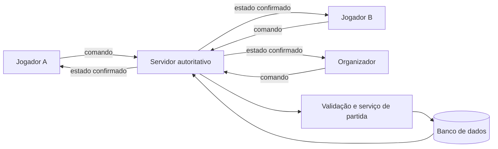

# AGENTS.md — Guerra dos Primos

## 1. Missão e ordem de prioridade

Construir uma aplicação web de apoio a um jogo educativo presencial ou remoto de domínio de territórios numerados. O tabuleiro deve ser acessível online e refletir o mesmo estado para todos os participantes. Não transformar o projeto em uma implementação completa de War tradicional.

**Prioridade absoluta:** mapa interativo, identificação dos jogadores, seleção de território, atribuição de domínio e sincronização entre navegadores. Somente depois de testes e aceite humano avançar para automatização das regras.

Leia `REGRAS.md` antes de alterar comportamento do jogo. Esse arquivo é a referência de domínio, enquanto este AGENTS.md define diretrizes técnicas. Em conflito ou lacuna, registre a dúvida e não invente regras. Uma decisão técnica provisória não passa a ser regra oficial.

## 2. Arquitetura proposta (decisões técnicas iniciais)

Adote um monólito modular TypeScript em um único repositório, com frontend e backend no mesmo deploy. Evite microserviços, filas, Redis, Kubernetes e abstrações prematuras.

| Camada | Escolha | Motivo |
|---|---|---|
| Interface | React + Vite + TypeScript | Desenvolvimento rápido, tipagem e testes de componentes |
| Tabuleiro | SVG com viewBox responsivo | Regiões clicáveis, escalabilidade e controle preciso de cores |
| Servidor | Node.js LTS + Express + Socket.IO | API simples e sincronização bidirecional |
| Validação | Zod | Contratos compartilhados e validação no servidor |
| Persistência | SQLite + better-sqlite3 | Ambiente local simples; implantação inicial de instância única |
| Testes | Vitest, React Testing Library, Playwright | Domínio, integração e fluxo multiplayer real |
| Qualidade | ESLint, Prettier, TypeScript strict | Mudanças previsíveis e verificáveis |
| Pacotes | npm workspaces + package-lock.json | Instalação reproduzível |

Use versões estáveis compatíveis, verificando requisitos na documentação oficial quando instalar. Não use versões imaginadas ou dependências sem necessidade. Caso a hospedagem não ofereça volume persistente ou exija múltiplas instâncias, reavalie SQLite (PostgreSQL é uma alternativa), documentando a mudança. Não dependa de filesystem efêmero em produção.

### Fluxo de dados



O servidor é a única fonte de verdade. Selecionar um território é uma ação local; modificar seu domínio exige autorização e confirmação do servidor. Nunca aceitar do cliente um estado completo como verdade. Não confundir cor geográfica original com cor de propriedade.

## 3. Estrutura desejada do repositório

```text
/
├── AGENTS.md
├── REGRAS.md
├── README.md
├── package.json
├── package-lock.json
├── .env.example
├── .gitignore
├── apps/
│   ├── web/
│   │   ├── src/
│   │   │   ├── features/board/
│   │   │   ├── features/session/
│   │   │   ├── components/
│   │   │   └── lib/
│   │   └── public/assets/
│   └── server/
│       └── src/
│           ├── game/
│           ├── sessions/
│           ├── transport/
│           └── persistence/
├── packages/
│   └── shared/src/
│       ├── contracts/
│       └── board/
├── tests/e2e/
└── docs/
    ├── DECISOES.md
    └── PROGRESSO.md
```

Estrutura orientativa: crie diretórios conforme necessidade, não arquivos vazios para cumprir o desenho. Mantenha domínio separado de HTTP, sockets, React e SQL. Use nomes de código em inglês, interface e documentação funcional em português. Não replique tipos ou constantes entre frontend e backend.

## 4. Tabuleiro: implementação crítica

O arquivo fornecido `Tabuleiro_mar.jpeg` é a referência visual. O usuário deve copiá-lo para o novo repositório (por exemplo `apps/web/public/assets/tabuleiro-original.jpeg`). Se faltar, não alegue que foi recebido nem invente geometria final; implemente uma fixture claramente identificada para testar o fluxo e registre o bloqueio do mapa real.

1. Catalogar todos os territórios visíveis no mapa e seus continentes. Há 42 números visíveis (9 América do Norte, 4 América do Sul, 7 Europa, 6 África, 12 Ásia, 4 Oceania). Conferir manualmente com o original, inclusive ilhas e fronteiras; usar `REGRAS.md` como inventário inicial, não como prova de geometria.
2. Vetorizar as fronteiras em um SVG com paths fechados e IDs estáveis. Territórios com ilhas podem usar múltiplos paths agrupados sob um único ID. O JPEG pode permanecer como fundo de referência, mas os números e as cores de domínio devem ser camadas controláveis. Não implementar áreas interativas com retângulos aproximados como versão final.
3. Separar geometria, metadados e estado de jogo. Cada região deve apontar para exatamente um registro de território. Renderizar números legíveis sobre qualquer cor de domínio; aplicar contraste, contornos e indicação textual de proprietário.
4. Usar `viewBox` baseado nas dimensões reais do original; manter proporção e alinhamento em diferentes tamanhos. Implementar foco, teclado (Enter/Espaço), toque e seleção por mouse. Não depender exclusivamente de hover ou cor.
5. Validar visualmente o resultado comparando com a imagem original. Não considerar vetorização automática correta sem inspeção. Confirmar direito de uso da imagem antes de publicação externa.

Cores dos continentes são geográficas, não representam jogadores. Um território neutro pode manter cor original com legenda; ocupado recebe indicação inequívoca de proprietário. Não supor adjacência geográfica, conexões marítimas ou mecânicas de War a partir do desenho.

## 5. Modelo mínimo de domínio

- `Continent`: `id`, `name`, `baseColor`.
- `TerritoryDefinition`: `id`, `number`, `continentId`, `labelPosition`; geometria SVG separada mas referenciada pelo ID. Número não é ID.
- `Player`: `id`, `displayName`, `color`, `seatIndex`.
- `GameSession`: `id`, `joinCode`, `status`, `revision`, jogadores, versão do tabuleiro, timestamps.
- `TerritoryState`: `sessionId`, `territoryId`, `ownerId: string | null`. Um único registro por território e partida.
- `SessionMembership`: vínculo entre participante e partida, papel (organizador/jogador), credencial de sessão protegida.

O catálogo é imutável durante uma partida. Propriedade e progresso pertencem à partida, nunca ao catálogo. Use chaves estrangeiras, unicidade e transações. Não persistir estado de interface (hover, seleção temporária) como estado do jogo.

Campos futuros como pontuação, vulnerabilidade, rodada e turno serão adicionados somente quando as respectivas fases forem autorizadas. Evite acoplar propriedade à classificação matemática: são conceitos distintos.

## 6. MVP: comportamento mínimo

A primeira versão deve permitir:

- Criar uma sala de teste com organizador, código de entrada e URL compartilhável; entrar de navegadores distintos com nome e cor identificável.
- Usar limite provisório de 2 a 6 jogadores para uma partida iniciada (sala pode existir antes disso), conforme trecho mais recente das anotações; validar no servidor e confirmar com responsáveis.
- Visualizar todo o tabuleiro, legenda e lista de participantes. Clicar/tocar uma região para consultar número, continente e proprietário atual.
- O jogador selecionar um território e solicitar domínio; o organizador poder confirmar a atribuição manualmente. No protótipo, esta mediação é um mecanismo técnico de teste, não regra oficial. Solicitação pode ser efêmera; não declarar entrega garantida após desconexão. Exibir erro se não enviada.
- Permitir ao organizador corrigir ou retirar domínio explicitamente, com confirmação da ação. Não disponibilizar tomada direta de território alheio pelo jogador. Não há julgamento automático da resposta matemática no MVP.
- Propagar qualquer alteração confirmada a todos na sala; recarregar o estado correto após atualizar a página ou reconectar.
- Persistir partidas, jogadores e domínio após reiniciar o servidor.

Não incluir no MVP: cálculo automático de pontuação, validação matemática de resposta, restrições de continente, combate automático, turnos bloqueantes, fim de jogo automático, ranking, bots, chat, contas permanentes, animações elaboradas ou geração aleatória de mapa.

## 7. Contratos e sincronização

Defina schemas Zod e tipos inferidos no pacote compartilhado. Contratos iniciais sugeridos:

- HTTP: `POST /api/sessions`, `POST /api/sessions/:code/join`, `GET /api/sessions/:id`, `GET /health`.
- Socket: `session:subscribe`, `territory:requestClaim`, `territory:setOwner`, `session:snapshot`.
- Comando de mutação: `commandId`, `sessionId`, `territoryId`, `ownerId` (ou null quando permitido), `expectedRevision`; identidade obtida da credencial validada, não de um ID declarado no payload.
- Resposta: confirmação ou erro estruturado (`FORBIDDEN`, `NOT_FOUND`, `CONFLICT`, `INVALID_INPUT`), revisão atual e dados necessários para ressincronizar.

Nomes são propostas, podem evoluir de forma documentada. Uma mutação válida deve ocorrer em transação: verificar associação, papel, revisão e território; atualizar estado e incrementar revisão; registrar ID de comando processado para impedir repetição; confirmar transação e só então emitir snapshot à sala correta. Conflito de revisão deve provocar ressincronização, não sobrescrita silenciosa. Broadcast de snapshot completo é aceitável para 42 territórios; clientes descartam snapshots antigos. Reconexão consulta snapshot autoritativo. Não depender exclusivamente de eventos incrementais.

## 8. Segurança e implantação

- Sessões anônimas com credencial aleatória forte, separada do código de entrada; código não concede privilégios de organizador. Preferir cookie HttpOnly, SameSite e Secure em produção, com proteção de origem para mutações e sockets.
- Validar payload, associação à sala, identidade, papel e limites de tamanho e frequência. Não confiar no frontend para autorização. Isolar salas. Escapar texto por renderização segura; não injetar SVG de fontes não confiáveis.
- Não expor tokens, segredos ou dados desnecessários em logs e snapshots. `.env` e arquivos do banco ficam fora do Git. Documentar backup e restauração.
- Deploy inicial em um serviço Node que suporte WebSocket, HTTPS e armazenamento persistente. Servir build do frontend na mesma origem; em desenvolvimento usar proxy Vite. Sem compromisso de hospedagem gratuita até verificar condições do provedor.
- Documentar comandos para PowerShell e ambiente Unix quando diferentes. Evitar scripts dependentes de Bash para operações essenciais.

## 9. Etapas e portões de aceite

| Fase | Entrega | Condição para avançar |
|---|---|---|
| 0 | Bootstrap, README, workspace, scripts, catálogo inicial | Instalação, build, lint e testes básicos funcionam |
| 1 | SVG, legenda, seleção, estado local de teste | 42 regiões verificadas; clique, teclado, toque e responsividade aprovados |
| 2 | Salas, servidor, domínio manual e banco | Dois navegadores exibem o mesmo estado; isolamento, permissões e persistência testados |
| 3 | Testes E2E, deploy de teste e revisão humana | Organizador valida a experiência do mapa real; sem defeitos críticos |
| 4 | Regras matemáticas, ordem circular, pontuação | Somente após aceite explícito do MVP e confirmação das regras afetadas |
| 5 | Ataques, expansão, encerramento e melhorias | Somente após resolução de ambiguidades relevantes em REGRAS.md |

O objetivo imediato inclui fases 0–3. Não iniciar fase 4 por conta própria, mesmo que seja fácil. Se imagem ou ambiente de deploy não estiverem disponíveis, completar o que for independente e registrar o bloqueio, sem declarar aceite.

## 10. Testes obrigatórios e definição de pronto

Configure scripts de raiz `npm run dev`, `npm run build`, `npm run lint`, `npm run typecheck`, `npm test`, `npm run test:e2e`. README deve descrever instalação (`npm ci` após gerar lockfile), execução, migração e deploy, incluindo como abrir dois navegadores na mesma sala.

Testes mínimos:

- Catálogo: IDs únicos, número e continente válidos, correspondência SVG–catálogo 1:1 e contagem esperada.
- Interface: cada região selecionável; proprietário legível; neutro distinto de ocupado; sem confundir cor de continente com jogador.
- Integração: membro autorizado, alteração inválida, usuário externo, jogador tentando comando de organizador, isolamento entre salas.
- Concorrência: dois comandos com a mesma revisão não sobrescrevem silenciosamente; duplicação de comando não aplica duas vezes.
- E2E: criar sala, entrar em dois contextos isolados, selecionar, solicitar, confirmar, verificar ambos, recarregar, reconectar, corrigir domínio.
- Persistência: reiniciar servidor com banco temporário persistente e recuperar estado.
- Inspeção visual: desktop e viewport móvel, verificar fronteiras e ilhas. Automatizar quando útil sem substituir conferência humana.

Pronto significa código implementado, testes pertinentes executados, build aprovado, documentação atualizada e limitações declaradas. Nunca marcar teste como aprovado sem execução; diferenciar falha, não executado e sucesso.

## 11. Fluxo de trabalho para Codex e demais agentes

1. Ler AGENTS.md, REGRAS.md, README e docs/PROGRESSO.md; verificar `git status` e estrutura real antes de mudar arquivos.
2. Identificar fase autorizada e produzir plano curto com critérios de aceite. Em pasta vazia, iniciar fase 0 e criar os documentos operacionais. Não pedir confirmação para decisões técnicas reversíveis já cobertas aqui.
3. Implementar pequenas fatias verticais, preservando alterações do usuário. Não reverter trabalho alheio, usar reset destrutivo, apagar banco real ou publicar remotamente sem autorização.
4. Adicionar testes junto à mudança; executar primeiro os focados e depois os comandos de qualidade aplicáveis. Corrigir a causa de falhas, não reduzir cobertura para obter verde.
5. Atualizar `docs/PROGRESSO.md` com fase, implementado, comandos executados/resultados, pendências e próximo passo; `docs/DECISOES.md` com data, contexto, decisão e consequências de escolhas arquiteturais relevantes.
6. Ao concluir cada tarefa, informar arquivos alterados, comportamento, testes efetivamente executados e limitações. Não fazer commits, push ou deploy sem solicitação explícita.

Se uma lacuna de regra impedir comportamento correto, não improvisar: documentar pergunta objetiva, manter o recurso desativado e avançar no trabalho independente. Mudanças em REGRAS.md que alterem regras exigem confirmação dos organizadores. Sugestões do agente devem ficar em DECISOES.md, não no texto normativo.

### Primeiro comando sugerido ao Codex (fora deste arquivo)

> Leia AGENTS.md e REGRAS.md. Inspecione a pasta e a imagem do tabuleiro. Implemente as fases 0 e 1 com testes, priorizando a fidelidade do mapa. Registre decisões, resultados e bloqueios em docs/. Não implemente regras automatizadas nem avance para a fase 2 antes da revisão do mapa.
